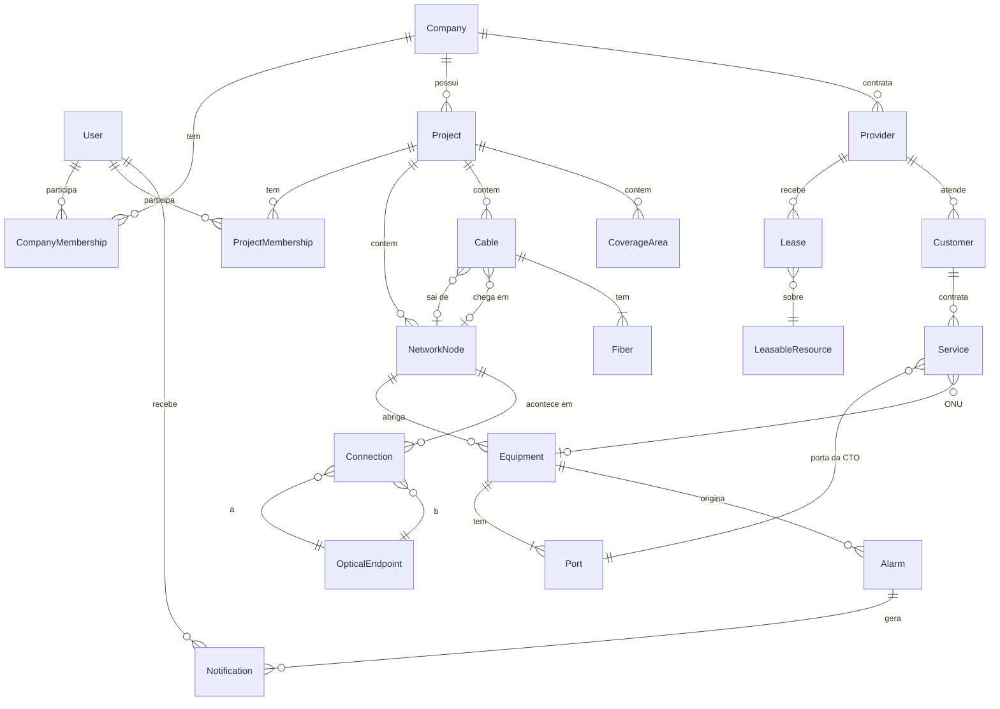

# Modelo de dados

Espelha `src/domain/types.ts`. Mudou um, mude o outro.

## Visão geral

`OpticalEndpoint` e `LeasableResource` não são tabelas: são referências polimórficas
(fibra **ou** porta).

## Camadas

### 1. Organização

`Company`, `User`, `CompanyMembership`, `Project`, `ProjectMembership`, `Provider`.

- O isolamento entre empresas é por `companyId`; entre projetos, por `projectId`.
- Papéis têm dois níveis: na empresa (`owner`, `admin`, `member`) e no projeto
  (`manager`, `designer`, `field`, `viewer`). Admin da empresa acessa todos os projetos.
- `Provider` pertence à empresa, não ao projeto — o mesmo provedor contrata em várias
  cidades.

### 2. Rede física

`NetworkNode` (ponto), `Cable` (linha), `CoverageArea` (polígono). É o que o editor
desenha hoje. Cada um tem `kind`, `name`, `status` e geometria.

`Cable.fromNodeId` / `toNodeId` / `viaNodeIds` são o grafo físico.

### 3. Rede óptica

`Fiber`, `Equipment`, `Port`, `Connection`.

- `Fiber` é gerada a partir de `Cable.fiberCount` e `fibersPerTube`; não é desenhada.
- `Equipment` vive dentro de um `NetworkNode`. Uma CTO é um nó que contém um splitter
  cujas saídas são as portas de atendimento (`role: "drop"`).
- `Connection` une dois `OpticalEndpoint` dentro de um nó. É a aresta do grafo óptico.

### 4. Comercial

`Lease`, `Customer`, `Service`.

- `Lease` é a cessão de um recurso a um provedor — o coração da rede neutra.
- `Service` amarra assinante → ONU → porta da CTO. O caminho até a OLT **não** é
  guardado: é calculado percorrendo o grafo óptico, para nunca divergir das fusões.

### 5. Monitoramento

`Alarm`, `Notification`. Ver `docs/04-arquitetura.md`.

## O que o editor guarda hoje

Sem backend, o editor persiste uma `FeatureCollection` GeoJSON por projeto
(`src/features/editor/model.ts`). Cada feature corresponde a um `NetworkNode`, `Cable`
ou `CoverageArea`, com as propriedades em `ElementProperties`.

Uma simplificação deliberada: as portas da CTO ficam em `properties.ports`
(`CtoPort`: situação, provedor, nome do cliente). No modelo completo isso se desdobra:

| Hoje (`CtoPort`) | Modelo completo |
| --- | --- |
| `index`, `status` | `Port` de um `Equipment` splitter na CTO |
| `providerId` | `Lease` ativa sobre a porta |
| `customerName` | `Service` → `Customer` |

A migração para o banco deve fazer esse desdobramento.

## Banco de dados (proposta)

PostgreSQL com PostGIS.

- Geometrias em `geometry(Point|LineString|Polygon, 4326)` com índice GiST.
- `project_id` em toda tabela de rede, com Row-Level Security por projeto.
- Unicidade parcial para "no máximo uma cessão vigente por recurso":
  índice único em `(resource_type, resource_id)` onde `status in ('reserved','active')`.
- Unicidade em `connection` para cada ponta (uma ponta, uma conexão).
- Caminho óptico por CTE recursiva sobre `connection` + `fiber`; materializar em tabela
  de cache se a consulta de viabilidade ficar lenta.
- Histórico: tabela de auditoria com quem alterou o quê — rede documentada sem
  histórico perde a confiança do campo.
