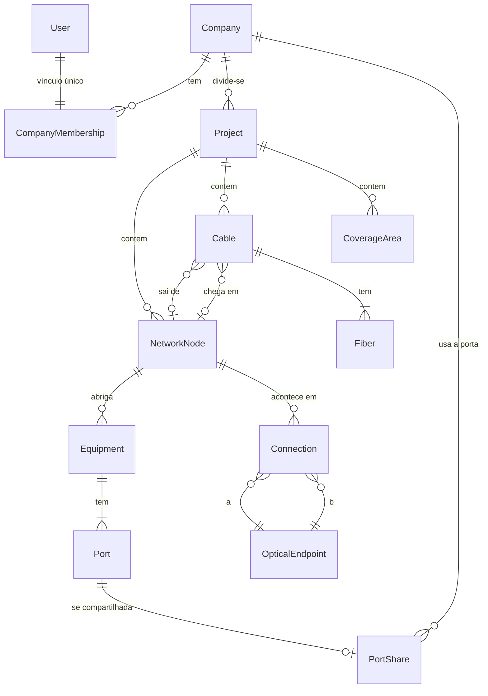

# Modelo de dados

Espelha `src/domain/types.ts`. Mudou um, mude o outro. Os nomes seguem
[`GLOSSARY.md`](../GLOSSARY.md).

## Visão geral

`OpticalEndpoint` não é tabela: é uma referência a uma fibra **ou** a uma porta.

## Camadas

### 1. Organização

`Company`, `User`, `CompanyMembership`, `Project`.

- `Company` é a organização da plataforma no perfil Seller; `companyId` é o
  `organization_id` de todos os serviços.
- Um usuário tem **um único** vínculo ativo, com um papel de Seller. O que cada papel
  pode fazer no editor está em `ROLE_ACCESS`.
- `Project` é um recorte livre da rede. Não há papel por projeto.
- A **Topologia** (tudo que um POP alimenta) não é entidade: é calculada
  (`computeRoutes`).

### 2. Rede física

`NetworkNode` (ponto), `Cable` (linha), `CoverageArea` (polígono). É o que se desenha
no mapa. Cada um tem `kind`, `name`, `status` e geometria.

`Cable.fromNodeId` / `toNodeId` / `viaNodeIds` formam o grafo físico. As duas pontas
de um cabo estão sempre no mesmo projeto.

### 3. Rede óptica

`Fiber`, `Equipment`, `Port`, `Connection` (a **Ligação** do glossário).

- `Fiber` é derivada de `Cable.fiberCount`; não é desenhada.
- `Equipment` vive dentro de um nó. Uma CTO contém um splitter cujas saídas são as
  portas de atendimento (`role: "drop"`).
- `Port` carrega a situação, se é **compartilhada** (`shared`) e, quando é porta
  própria em uso, o **assinante** como texto livre (`subscriber`).
- `Connection` une duas pontas dentro de um nó: fusão, conector ou cordão.

### 4. Rede neutra

`PortShare` — o **Compartilhamento**: outra Empresa usando uma porta compartilhada.

- Nasce de um pedido aceito no marketplace (`orderId`); o editor não cria (ADR 0005).
- Uma porta tem no máximo um compartilhamento ativo.
- Da porta compartilhada, o editor guarda a ocupação, nunca o assinante.

### 5. Monitoramento

`Alarm`, `Notification`. Ficam para outra fase.

## O que o editor guarda hoje

Sem integração, o editor persiste no navegador, por projeto:

- uma `FeatureCollection` GeoJSON com nós, cabos e áreas
  (`src/features/editor/model.ts`);
- equipamentos cadastrados e ligações do diagrama (`src/features/diagram/model.ts`).

Simplificações deliberadas:

| Hoje | Modelo completo |
| --- | --- |
| `CtoPort` nas propriedades da CTO (`status`, `shared`, `subscriber`) | `Port` do splitter da CTO |
| Splitter da CTO e de 1º nível da CEO derivados das propriedades | `Equipment` + `Port` |
| Porta marcada como compartilhada, sem dizer com quem | `PortShare`, vindo do marketplace |

Dados gravados com o vocabulário antigo (elemento "cliente", provedor na porta) são
convertidos ao carregar (`migrateCollection`).

## Onde isso vai morar

Na geo (ADR 0002). Cada Projeto é um **rascunho de cobertura** (ADR 0003):

| Editor | Rascunho de cobertura da geo |
| --- | --- |
| Projeto | O rascunho |
| Nó, cabo, área | Feição (ponto, linha, polígono) |
| `kind` | `asset_type` — hoje só `cto`, `fiber_cable`, `splice_closure`, `pole`, `coverage_area` |
| `name`, `notes` | `name`, `description` |
| Demais propriedades | `attributes` (texto → texto) |
| Portas, equipamentos, ligações | `attributes` da feição do nó, provisoriamente (ADR 0007) |
| Controle de versão | `expected_revision` por feição |

Limite: 20.000 feições por rascunho. O que falta na geo está em
`docs/13-pedidos-a-outros-times.md`.
